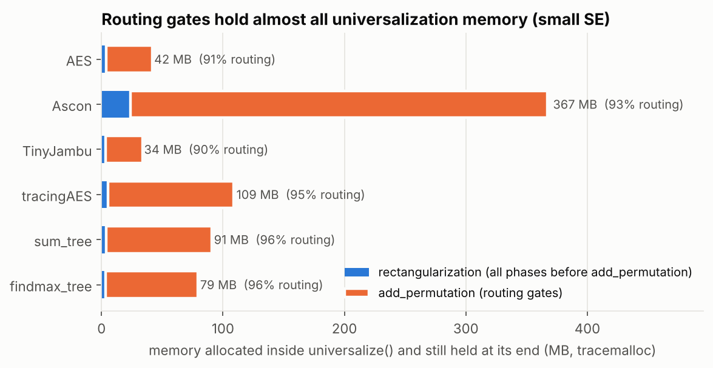
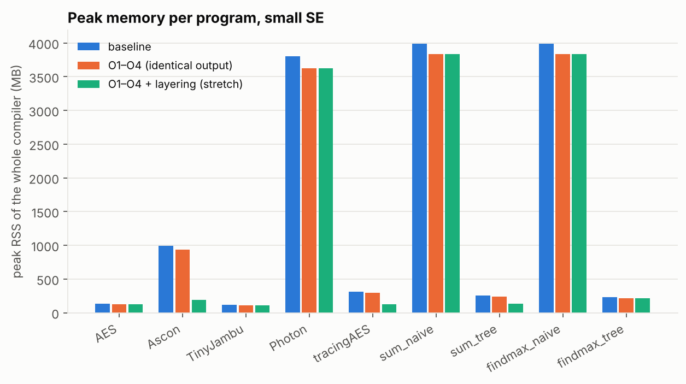
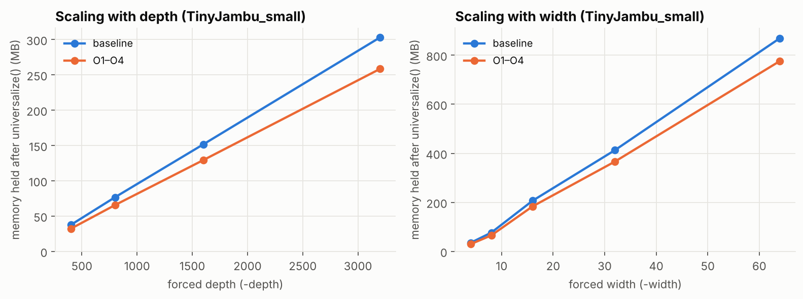

# Memory-Efficient Universalization in OBSCURE: Project Report

## 1. Summary

OBSCURE (Mercadier, Nguyen, Rivain, Udovenko, TCHES 2024) hides a program's data
flow through *rectangular universalization*. The program is reshaped into layers of
equal width, and every pair of consecutive layers is joined by a Beneš-based
permutation-and-copy network. We set out to reduce the memory of this pass without
changing the obfuscated output.

Main results:

* **Profiling changed the picture.** About 90% of the memory allocated inside
  `universalize()` is the routing gates of the permutation networks, and that memory
  is held until the end of the pass. Peak and final memory differ by at most a few
  MB. The temporary structures our proposal targeted (O1–O3) are therefore not where
  the peak is.
* **O1–O3 were implemented as proposed and produce byte-identical output.** Their
  memory effect is negligible, as profiling predicted. O3 halves universalization
  time on wide programs (sum_tree, findmax_tree: −50%).
* **O4, added because of the profiling results, gives the memory reduction while
  keeping the output identical.** It releases DFG bookkeeping that later passes never
  read. Whole-compiler peak memory drops on all 36 program/SE configurations, by
  0.2–9.6% (median 5.9%, i.e. 150–190 MB on the 4 GB compilations). Memory held after
  universalization drops by 10–28%. All 36 configurations are byte-identical to the
  original.
* **Stretch goal: width-balancing layering** changes (and shrinks) the circuit. A
  guard applies it only when the permutation networks are predicted to get smaller,
  which happened in 9 of 36 configurations. There, peak memory drops by 40–81%: Ascon
  small 994 → 187 MB, Photon medium 4.6 → 2.4 GB, Photon xlarge 1.5 → 0.7 GB, with
  1.9–6× fewer instructions. Elsewhere the output is unchanged. Functional tests and
  the rectangular invariants pass in every changed configuration we could test (see section 6 for Photon xlarge).

## 2. Setup and method

**Scope.** All compiler changes are in the three universalization files
(`universalizer.py`, `rectangularize.py`, `routing.py`). `main.py` only gained
command-line flags, the reproducibility switch behind `-seed` described below, and an
LLMI count in `-stats`. Every optimization sits behind its own flag (`-opt-o1` …
`-opt-o4`, `-opt-all`, `-opt-layering`) and is off by default.

**Environment.** Python 3.13 on a 2-core, 7 GB Linux machine. Package installation
wasn't possible, so `pysodium`, `graphviz` and the SWIG Schwaemm module were replaced
by minimal stand-ins in `env_shims/` (ctypes on the system libsodium and on the
Schwaemm C code shipped with OBSCURE). The compiler itself is unchanged.

**Reproducible output.** The original compiler isn't deterministic, even with a
fixed random seed. `MLMI` objects have no `__hash__`, so the sets holding them iterate
in memory-address order. `-seed N` therefore also gives each `MLMI` a hash equal to
its creation index (with `PYTHONHASHSEED=0`). This fixes the iteration order without
changing what any pass computes, and it is used for the baseline and the optimized
runs alike. The 64-byte sealed-key header is randomized by libsodium by design, so
comparisons mask those bytes. Every other byte, including all encrypted
instructions, is compared.

**Metrics.**

* Whole-compiler peak RSS, from `wait4` with no profiler attached.
* Memory allocated inside `universalize()`, from `tracemalloc` via `-profile-mem`,
  both per phase and still held at the end.
* Universalization and total compile time.
* #MLMIs/#LLMIs and bytecode size.
* A SHA-256 digest of the (masked) bytecode.

**Benchmarks.** AES, Ascon, TinyJAMBU, Photon, traceable AES, sum and findmax (naive
and tree), on the four SE sizes of the paper (small/medium/large/xlarge = l of 8, 16,
32, 64). mnist was dropped: its frontend alone ran past our 30-minute limit
(section 7).

## 3. Profiling findings



`-profile-mem` probes every phase of `universalize()`
(`results/profile_by_phase.csv`, `results/PROFILE.md`). In all six profiled programs
and all four SE sizes, 86–96% of
the memory still held at the end of the pass is created by `add_permutation`.
Rectangularization's temporaries account for the rest. Peak memory is almost always
reached at the very end (peak above end ≤ 3.5 MB), so the pass mostly *accumulates
output* rather than building big temporaries.

An allocation-site breakdown for AES on the small SE (`scripts/alloc_breakdown.py`)
attributes the 45.6 MB held at the end as follows:

| Allocation site | MB |
| --- | ---: |
| `HLI(MOV, …)` of routing gates | 10.7 |
| new `MemOperand` per gate output (+ its int) | 7.1 + 2.8 |
| `dfg.backward_edges` dict | 5.0 |
| `forward_edges` successor sets (+ empty placeholder sets) | 3.8 + 2.4 |
| gate input lists | 3.3 |
| `MLMI` / `MLS` objects, `dfg.nodes` | 2.3 |

The gate objects *are* the output and can't be removed without changing it. The
edge structures and the `backward_edges` table are bookkeeping, and after
universalization only the scheduler in `DFG.to_LLIR()` reads `forward_edges`. This
observation led to O4.

The heavy programs show why this matters. On the small SE, the original compiler
peaks at about **4 GB** for sum_naive and findmax_naive and **3.8 GB** for Photon
(**4.6 GB** on the medium SE). With the profiler on, sum_naive was killed by the
out-of-memory killer at 4.6 GB.

## 4. Optimizations

### O1: leaner rectangularization (`-opt-o1`)

* **Sparse alternative definitions.** `segregate_layers` allocated a list as long as
  the whole depth for every variable copied through layers:

  ```python
  # before
  alternative_defs[old_m] = [ None for _ in range(len(layers)) ]
  alternative_defs[old_m][layer] = new_m
  # after (-opt-o1): one dict keyed by (variable, layer)
  alternative_defs[(old_m, layer)] = new_m
  ```
* **Shared padding constant.** Every `MOV out, 0` padding instruction used a fresh
  `ImmOperand(0)`. They now share one immutable instance.
* **Not done:** rewriting `layerize` with Kahn's algorithm. It produces the same layer
  numbers but a different order of nodes within each layer, so the bytecode would
  change. Its memory is negligible (rectangularize peaks at a few MB), so we kept the
  original.

### O2: incremental routing generation (`-opt-o2`, `routing.py`)

The original built, for every layer, the input Beneš network, the copy network and
the output Beneš network at once (`BDBFuncMI`). It then made a full canonical copy of
the column list and an optimized copy of that. `iter_bdb_columns()` yields the same
columns one at a time instead. Each sub-network is dropped once its columns are
consumed, identity wirings are filtered on the fly, and columns are stored as
`array('i')`. `test_iter_bdb_columns()` checks on 400 random routing problems that
the column sequence is identical to `optimize(BDBFuncMI(f).canonical())`.

### O3: in-place gate application (`-opt-o3`)

`apply_secret_perm` copied the entire wire list and the checker list for every secret
gate, which is O(n²/l) copying per network column:

```python
# before                                   # after (-opt-o3)
new_inputs = list(inputs)                  window = inputs[off:off+k]
new_inputs_checker = list(inputs_checker)  window_chk = inputs_checker[off:off+k]
...                                        ...
new_inputs[off+i] = out                    inputs[off+i] = out
for i in range(len(inputs)):               inputs_checker[off+i] = window_chk[idx]
    inputs[i] = new_inputs[i]
```

Nodes, operands and instructions are created in the same order, so the output is
identical. The full routing self-check is kept (now in place), `-debug-routing` adds
an independent check per layer, and the unused `inputs_pos_rev` map is no longer
built.

### O4: compact hand-off to lowering (`-opt-o4`, added after profiling)

At the end of `universalize()` (after the integrity check):

* `backward_edges` is released. No later pass reads it.
* The empty successor sets (cleared before-layer sets and `defaultdict` placeholders)
  are dropped. Missing keys now return one shared empty `frozenset` without being
  stored.
* `dfg.prog`, the pre-clustering program, which keeps one wrapper `MLMI`, `MLS` and
  lists per source instruction alive, is replaced by an object holding only its
  `inputs`, the one field `to_LLIR` reads.

A first version also turned the non-empty successor sets into tuples. That
**changed the bytecode**. The scheduler calls `todo.update(successors)`, and CPython's
set-to-set update copies the source set's internal table layout, so the scheduling
order depended on the container type. The identical-output check caught this, and
the non-empty sets are now left untouched.

### Stretch goal: width-balancing layering (`-opt-layering`)

`layerize` places every node as early as possible (ASAP). Crowded layers make *every*
layer, and every permutation network, as wide as the widest one. Each node can
legally sit between its ASAP layer and its ALAP layer (the latest layer strictly
before all its successors). We place nodes in ASAP order, each into the least-loaded
layer of its window (list scheduling for minimum width). Pure ALAP was tried first
and made AES wider (6 to 8), so a **guard** decides between the original and the
balanced assignment:

* It estimates the rectangular width of each assignment: nodes plus pass-through
  copies, where copies first use the spare input/output/instruction slots of existing
  nodes (as `segregate_layers` does) and the rest are packed min(l_in, l_out) per new
  node.
* It switches only if the balanced assignment lands in a **strictly smaller
  permutation-network size** (the next power of two of width × l), because that size
  drives the gate count. Otherwise the output stays byte-identical to the original.

The guard went through one important revision. The first version compared raw
width estimates without modeling spare capacity. On Photon (small SE) it estimated
62 vs. 60, chose the balanced layering, and the real widths turned out to be 56 vs.
65. Width 65 × 8 = 520 wires rounds up to a 1,024-wire network instead of 512, which
doubled every network, and the compilation was killed at 5.9 GB. With the revised
guard, the estimate is exact for 10 of the 12 configurations we checked and off by
at most 3 for Photon (`results/layering_guard_check.txt`). The decision was right in
all 12, and Photon small now keeps its original layering.

## 5. Results

### 5.1 Identical output

| Configuration | byte-identical / compared |
| --- | ---: |
| +O1 (small SE, six light programs) | 6 / 6 |
| +O1+O2 | 6 / 6 |
| +O1+O2+O3 (small SE, all programs) | 9 / 9 |
| +O1..O4 (all programs, all SE sizes) | **36 / 36** |
| +O1..O4 with `-profile-mem` | 24 / 24 |

### 5.2 Ablation (whole-compiler peak RSS in MB, small SE)



| Program | baseline | +O1 | +O1+O2 | +O1+O2+O3 | +O1..O4 | +O1..O4 +layering | change O1..O4 | change +layering |
| --- | ---: | ---: | ---: | ---: | ---: | ---: | ---: | ---: |
| AES | 134.0 | 134.2 | 134.2 | 134.2 | 125.1 | 125.0 | -6.7% | -6.7% |
| Ascon | 993.7 | 990.5 | 990.6 | 990.6 | 936.0 | 187.1 | -5.8% | -81.2% |
| TinyJambu | 120.5 | 120.4 | 120.7 | 120.6 | 110.1 | 109.8 | -8.7% | -8.9% |
| Photon | 3,805.2 | - | - | 3,799.5 | 3,623.2 | 3,622.8 | -4.8% | -4.8% |
| tracingAES | 315.2 | 315.5 | 315.7 | 315.7 | 296.7 | 128.3 | -5.9% | -59.3% |
| sum_naive | 3,986.2 | - | - | 3,979.1 | 3,833.7 | 3,833.2 | -3.8% | -3.8% |
| sum_tree | 253.1 | 252.5 | 252.1 | 252.0 | 240.4 | 131.9 | -5.0% | -47.9% |
| findmax_naive | 3,991.3 | - | - | 3,987.3 | 3,835.9 | 3,834.6 | -3.9% | -3.9% |
| findmax_tree | 228.0 | 227.5 | 227.0 | 227.1 | 214.8 | 214.5 | -5.8% | -5.9% |

For Photon, sum_naive and findmax_naive (3.8–4.0 GB each), the intermediate steps
+O1 and +O1+O2 weren't run separately. +O1+O2+O3 was.

O1–O3 change peak RSS by less than 1%, consistent with section 3. All the savings
from identical-output changes come from O4.

### 5.3 All SE sizes

**O1–O4 (byte-identical output)** lower whole-compiler peak RSS on every one of the
36 configurations, by 0.2–9.6% (median 5.9%), and the memory held after
universalization by 10–28%. **Layering** changes the program in the configurations
below. Everywhere else the guard keeps the original program and the result equals
O1–O4:

| Program | SE | peak RSS base (MB) | O1..O4 | change | +layering | change | held after universalize base (MB) | O1..O4 | #LLMIs base | +layering |
| --- | --- | ---: | ---: | ---: | ---: | ---: | ---: | ---: | ---: | ---: |
| Ascon | small | 993.7 | 936.0 | -5.8% | 187.1 | -81.2% | 367.8 | 323.7 | 120,188 | 20,033 |
| Ascon | medium | 508.7 | 469.3 | -7.7% | 144.8 | -71.5% | 172.1 | 147.9 | 31,463 | 8,051 |
| Ascon | large | 175.2 | 163.0 | -7.0% | 103.7 | -40.8% | 44.1 | 38.5 | 4,863 | 2,584 |
| Photon | medium | 4,625.7 | 4,440.6 | -4.0% | 2,446.8 | -47.1% | - | - | 337,497 | 174,875 |
| Photon | xlarge | 1,456.1 | 1,346.6 | -7.5% | 675.3 | -53.6% | - | - | 22,665 | 10,983 |
| tracingAES | small | 315.2 | 296.7 | -5.9% | 128.3 | -59.3% | 109.3 | 98.5 | 37,030 | 12,800 |
| tracingAES | large | 130.6 | 121.8 | -6.8% | 77.7 | -40.5% | 34.3 | 28.8 | 3,469 | 1,846 |
| sum_tree | small | 253.1 | 240.4 | -5.0% | 131.9 | -47.9% | 90.9 | 80.1 | 28,381 | 14,449 |
| sum_tree | large | 130.4 | 124.3 | -4.6% | 55.7 | -57.2% | 39.3 | 33.8 | 3,792 | 1,286 |

The full 36-row table is in Appendix A and `results/ablation_table.md`.

### 5.4 Compile time (median of 3, small SE, one job at a time)

| Program | universalize base (s) | O1..O4 (s) | change | total base (s) | O1..O4 (s) | change |
| --- | ---: | ---: | ---: | ---: | ---: | ---: |
| AES | 1.16 | 1.12 | −3% | 4.93 | 4.89 | −1% |
| Ascon | 11.12 | 10.76 | −3% | 29.37 | 28.98 | −1% |
| TinyJambu | 0.74 | 0.86 | +16% | 2.31 | 2.65 | +15% |
| tracingAES | 3.13 | 2.72 | −13% | 12.30 | 11.69 | −5% |
| sum_tree | 5.37 | 2.68 | **−50%** | 8.22 | 5.62 | −32% |
| findmax_tree | 4.64 | 2.30 | **−50%** | 7.33 | 4.81 | −34% |

O3 removes the per-gate full-list copies, which grow as O(n²) in layer width, so the
gain is largest on wide layers (width 186). TinyJambu (width 3, depth 349) is the
exception. Its total time rose by 0.34 s, of which only 0.12 s is in universalization,
the only pass we changed. We attribute the rest to run-to-run variation on sub-second
runs. The per-layer overhead of the O2 generator on 349 tiny layers may account for
part of the 0.12 s.

### 5.5 Scaling



We forced depth (400–3,200) and width (4–64) on TinyJambu. The memory held after
`universalize()` grows linearly with depth and roughly as n·log n with width, as
predicted by the paper's 2·d·n·log n gate count. O1–O4 lower it by a constant
11–15% (for example 303 → 258 MB at depth 3,200, and 870 → 776 MB at width 64), but
they **don't change the asymptotic growth**, because what grows is the output itself.
Only a smaller circuit (layering) changes the growth.

## 6. Correctness and security evidence

* **Identical bytecode** for O1–O4 on all 36 configurations (section 5.1). The
  obfuscated program is the same, so the paper's security argument applies unchanged.
* **Functional tests** (`scripts/run_tests_flags.pl`, the repository's own test
  runner: the obfuscated program runs in the interpreter and is compared with the
  plain C build on random inputs):
  * basic + medium suite: 53/54 with `-opt-all` and 53/54 with layering. The one
    failure, `msb32_from_mul`, also fails with the original compiler: its `.info`
    names a function `mult32` that doesn't exist, so gcc can't build the reference.
  * benchmark programs, small SE: 6/6 with `-opt-all` and 6/6 with layering (Photon,
    sum/findmax_naive excluded for time). The interpreter's SE size is fixed at build
    time, so we built extra interpreters to test the layering-changed programs on
    other sizes: medium SE 2/2 (Photon, Ascon), large SE 4/4 (Ascon, tracingAES,
    sum_tree, AES). On the extra-large SE, Photon gives wrong output with the
    **original** compiler too (and with O1–O4), so this pre-existing issue prevents a
    functional check of layering on that configuration. Its structure check passes.
    (The extra-large interpreter itself passes the other tests we ran.)
* **Routing.** O2's column generator is checked against the original on 400 random
  routing problems. The in-place gate application keeps the full routing self-check.
* **Rectangular invariants for layering** (`scripts/check_structure.py`, on every
  configuration where layering changed the program): every middle layer has the same
  width, every multi-instruction has exactly l_in inputs and l_out outputs, all
  program outputs are in the last layer, and a permutation network sits between
  every pair of layers. All pass. Width and depth can still be padded to public
  values with `-width` and `-depth`.

## 7. Limitations and deviations from the proposal

* **O1–O3 save time, not memory.** The proposal expected the savings to come from
  temporary structures. Profiling showed the peak is the accumulated output, so we
  added O4. The proposal's risk section anticipated this.
* **Kahn's-algorithm `layerize` (O1) wasn't adopted**, because it would change the
  order within layers and therefore the output.
* **mnist excluded.** One compilation didn't finish within 30 minutes, and it was
  still in the frontend (memory flat at 434 MB), before universalization.
* **Profiler overhead.** tracemalloc roughly doubles memory, so all RSS numbers come
  from runs without it. Per-phase profiles of the 3–5 GB cases (Photon small/medium,
  sum_naive small) didn't fit in 7 GB and are reported only where they completed.
* **Photon on the extra-large SE fails the functional test with the original
  compiler.** We didn't investigate this pre-existing issue. As a result, the layering
  result for that configuration (1,456 → 675 MB) is supported only by the structure
  check, not by a functional test.
* **Ablation intermediates** (+O1, +O1+O2, +O1+O2+O3) were measured on the small SE.
  Timing medians come from three runs on a 2-core machine.
* **Deterministic mode** patches `MLMI.__hash__` from `main.py`. It is needed to
  compare outputs at all, and it applies to both baseline and optimized runs.
* **Layering is a heuristic.** The first guard caused an out-of-memory failure on
  Photon (section 4). The revised guard is conservative: it only switches when the
  network size halves, so it skips smaller gains (for example findmax_tree, 186 → 137,
  which stays in the same 2,048-wire bucket). It is still an estimate.
* **Time on large SEs.** In single runs on the heavy programs, O1–O4 make
  universalization about 20% faster on the small SE (sum_naive 70.8 → 56.6 s), but
  9–24% slower on the large and extra-large SEs (Photon xlarge 139.8 → 154.0 s). The
  likely cause is O2's per-column conversion to arrays, which costs more with 32- and
  64-wide gates. Making O2 optional per SE size, or removing the conversion, are
  obvious next steps.

## 8. Future work

* Store routing gates more compactly. They are about 70% of the remaining memory, but
  that requires changing the IR (`__slots__`, operands stored as integer IDs), which
  was outside our scope.
* Stream finished layers straight to lowering and the serializer, so peak memory
  would depend on width rather than depth.
* Better layer assignment, for example an exact width-minimizing ILP for small
  programs, or Coffman–Graham layering.

## 9. Reproducing

See `README_PROJECT.md`. `sh scripts/run_all.sh` reruns everything, and
`results/results.csv` holds every individual run.

## Appendix A: all programs and SE sizes

| Program | SE | peak RSS base (MB) | O1..O4 | change | +layering | change | held after universalize base (MB) | O1..O4 | #LLMIs base | +layering |
| --- | --- | ---: | ---: | ---: | ---: | ---: | ---: | ---: | ---: | ---: |
| AES | small | 134.0 | 125.1 | -6.7% | 125.0 | -6.7% | 42.0 | 36.6 | 12,849 | 12,849 |
| AES | medium | 79.0 | 75.0 | -5.1% | 74.9 | -5.2% | 17.2 | 14.4 | 3,327 | 3,327 |
| AES | large | 57.6 | 54.8 | -4.8% | 54.8 | -4.8% | 8.9 | 7.4 | 986 | 986 |
| AES | xlarge | 46.5 | 46.4 | -0.2% | 45.8 | -1.5% | 2.0 | 1.4 | 117 | 117 |
| Ascon | small | 993.7 | 936.0 | -5.8% | 187.1 | -81.2% | 367.8 | 323.7 | 120,188 | 20,033 |
| Ascon | medium | 508.7 | 469.3 | -7.7% | 144.8 | -71.5% | 172.1 | 147.9 | 31,463 | 8,051 |
| Ascon | large | 175.2 | 163.0 | -7.0% | 103.7 | -40.8% | 44.1 | 38.5 | 4,863 | 2,584 |
| Ascon | xlarge | 117.9 | 106.8 | -9.5% | 106.5 | -9.7% | 25.3 | 20.0 | 1,360 | 1,360 |
| TinyJambu | small | 120.5 | 110.1 | -8.7% | 109.8 | -8.9% | 34.1 | 28.5 | 11,201 | 11,201 |
| TinyJambu | medium | 72.1 | 66.7 | -7.5% | 66.6 | -7.7% | 15.5 | 12.8 | 2,959 | 2,959 |
| TinyJambu | large | 67.8 | 61.3 | -9.6% | 61.2 | -9.8% | 14.0 | 11.3 | 1,445 | 1,445 |
| TinyJambu | xlarge | 72.0 | 65.2 | -9.5% | 65.1 | -9.6% | 13.8 | 11.1 | 748 | 748 |
| Photon | small | 3,805.2 | 3,623.2 | -4.8% | 3,622.8 | -4.8% | - | - | 473,744 | 473,744 |
| Photon | medium | 4,625.7 | 4,440.6 | -4.0% | 2,446.8 | -47.1% | - | - | 337,497 | 174,875 |
| Photon | large | 638.1 | 588.0 | -7.8% | 587.7 | -7.9% | - | - | 20,711 | 20,711 |
| Photon | xlarge | 1,456.1 | 1,346.6 | -7.5% | 675.3 | -53.6% | - | - | 22,665 | 10,983 |
| tracingAES | small | 315.2 | 296.7 | -5.9% | 128.3 | -59.3% | 109.3 | 98.5 | 37,030 | 12,800 |
| tracingAES | medium | 131.4 | 119.8 | -8.9% | 119.6 | -9.0% | 34.8 | 29.4 | 6,383 | 6,383 |
| tracingAES | large | 130.6 | 121.8 | -6.8% | 77.7 | -40.5% | 34.3 | 28.8 | 3,469 | 1,846 |
| tracingAES | xlarge | 85.2 | 78.4 | -7.9% | 78.3 | -8.0% | 16.5 | 13.9 | 927 | 927 |
| sum_naive | small | 3,986.2 | 3,833.7 | -3.8% | 3,833.2 | -3.8% | - | - | 516,001 | 516,001 |
| sum_naive | medium | 1,493.8 | 1,413.2 | -5.4% | 1,407.8 | -5.8% | 529.8 | - | 96,501 | 96,501 |
| sum_naive | large | 479.0 | 455.6 | -4.9% | 455.5 | -4.9% | 169.2 | - | 15,935 | 15,935 |
| sum_naive | xlarge | 250.9 | 235.1 | -6.3% | 234.8 | -6.4% | 75.4 | - | 4,000 | 4,000 |
| sum_tree | small | 253.1 | 240.4 | -5.0% | 131.9 | -47.9% | 90.9 | 80.1 | 28,381 | 14,449 |
| sum_tree | medium | 70.4 | 66.3 | -5.8% | 66.2 | -6.0% | 17.1 | 14.4 | 3,089 | 3,089 |
| sum_tree | large | 130.4 | 124.3 | -4.6% | 55.7 | -57.2% | 39.3 | 33.8 | 3,792 | 1,286 |
| sum_tree | xlarge | 135.1 | 127.3 | -5.8% | 127.0 | -6.0% | 38.5 | 32.9 | 1,951 | 1,951 |
| findmax_naive | small | 3,991.3 | 3,835.9 | -3.9% | 3,834.6 | -3.9% | 1,602.3 | - | 516,001 | 516,001 |
| findmax_naive | medium | 1,495.4 | 1,414.2 | -5.4% | 1,413.9 | -5.5% | 529.8 | - | 96,501 | 96,501 |
| findmax_naive | large | 486.2 | 462.5 | -4.9% | 462.3 | -4.9% | 171.1 | - | 16,192 | 16,192 |
| findmax_naive | xlarge | 258.4 | 242.2 | -6.3% | 242.1 | -6.3% | 77.6 | - | 4,129 | 4,129 |
| findmax_tree | small | 228.0 | 214.8 | -5.8% | 214.5 | -5.9% | 79.6 | 69.0 | 24,318 | 24,318 |
| findmax_tree | medium | 72.5 | 67.3 | -7.2% | 67.2 | -7.2% | 16.8 | 14.1 | 3,089 | 3,089 |
| findmax_tree | large | 114.7 | 107.8 | -6.0% | 107.5 | -6.2% | 32.3 | 27.0 | 3,032 | 3,032 |
| findmax_tree | xlarge | 136.7 | 128.5 | -6.0% | 128.4 | -6.1% | 38.4 | 32.8 | 1,954 | 1,954 |

## References

* D. Mercadier, V. S. Nguyen, M. Rivain, A. Udovenko. *OBSCURE: Versatile Software
  Obfuscation from a Lightweight Secure Element.* IACR TCHES 2024(2), 588–629.
  doi:10.46586/tches.v2024.i2.588-629
* OBSCURE source code: https://github.com/CryptoExperts/OBSCURE
